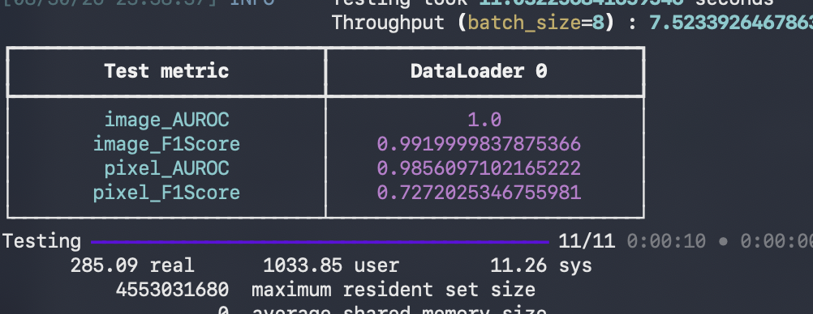

# PatchCore + MVTec AD Bottle基线

## 环境

- Python：3.12
- Anomalib：2.6.0
- 模型：PatchCore
- Backbone：wide_resnet50_2
- 设备：Mac CPU
- 训练Batch Size：8
- 评估Batch Size：8
- Num Workers：0
- Coreset Sampling Ratio：0.1
- Num Neighbors：9
- 结果在`/Users/yangfan/CS/InspectFlow/training/outputs/patchcore_bottle_baseline/Patchcore/MVTecAD/bottle/v1/images/test`

## 测试指标

- Image AUROC：1.0000
- Image F1Score：0.9920
- Pixel AUROC：0.9856
- Pixel F1Score：0.7272

## 性能

- 端到端运行时间：285.09秒
- 峰值常驻内存：4553031680字节，约4.24 GiB
- 测试耗时：约11秒
- 测试吞吐量：约7.52张/秒

## 结果分析

1. 图片级分类效果非常好，正常和异常样本基本完全分离。
2. 模型能够正确关注小破损和污染区域。
3. Pixel AUROC很高，但Pixel F1只有约0.727，说明异常排序能力较好，但阈值化后的缺陷边界仍存在偏差。
4. 正常样本没有出现明显预测轮廓。
5. 后续需要进一步分析不同缺陷类型的定位效果和阈值敏感性。

## 复盘

+ 
