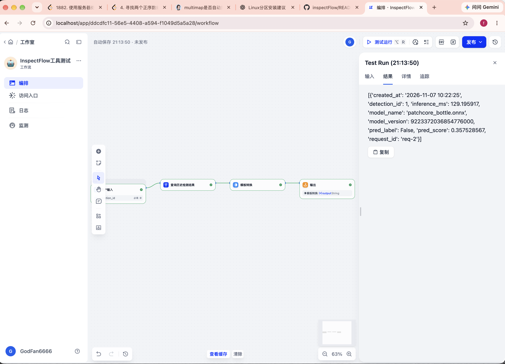
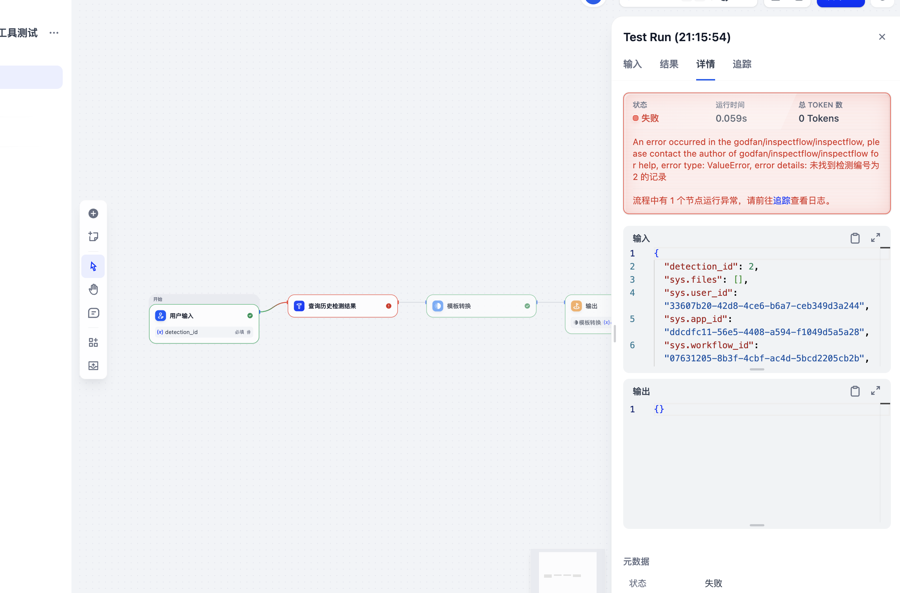
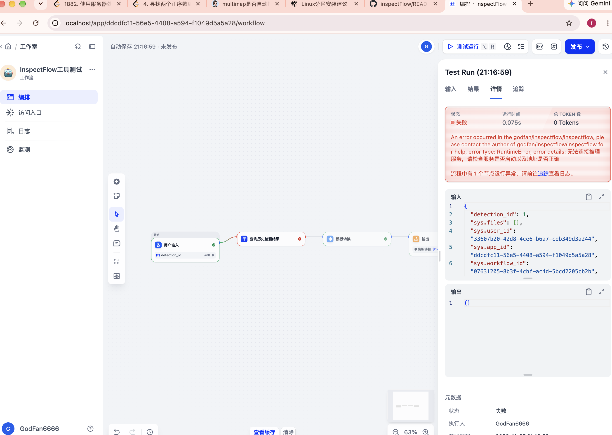

## 第十一周

+ 解决的问题
  + 现在你上传图片后，服务会返回检测结果。但这份结果主要存在于本次响应中：
    - 关闭页面后，不方便再次查询。
    - 服务重启后，不能通过接口找回之前的检测。
    - 当前 `request_id` 是进程内递增编号，重启后可能重复，不适合充当永久检测记录编号。

### day1-设计检测记录，区分两种编号

```c++
//先构建数据库表存储的值
struct DetectionRecord {
    std::string created_at;
    std::string request_id;

    std::string model_name;
    std::optional<std::int64_t> model_version;

    double pred_score;
    bool pred_label;
    double inference_ms;
};

//数据库查询结果用如下表示
struct StoredDetection {
    std::int64_t detection_id;
    DetectionRecord record;
};
```

### day2-学习 SQLite 的 C++ 调用方式，完成独立存取

+ 增加了管理据库的类`detection_store.cpp` 和`detection_store.hpp` 负责读取、创建、插入、查找数据库的操作
+ 其中有些需要讲解的问题

```c++
//两个指针
sqlite3* db = nullptr;//打开的数据库连接，代表你正在操作哪个数据库
sqlite3_stmt* stmt = nullptr;//一条准备好执行的 SQL，例如插入或查询
//语句的生命周期：程序打开一次数据库，在多个操作中复用。每次操作准备自己的 SQL 语句，用完释放。最后关闭数据库

//打开数据库
sqlite3* db = nullptr;

int rc = sqlite3_open("practice.db", &db);//"practice.db"：数据库文件路径；默认情况下不存在就尝试创建。
//rc：返回状态码，不能忽略。
if (rc != SQLITE_OK) {
    // 打开失败
}

//连接后建一张最简单的表
CREATE TABLE IF NOT EXISTS detections (
    detection_id INTEGER PRIMARY KEY,
    pred_score REAL NOT NULL,
    pred_label INTEGER NOT NULL CHECK(pred_label IN (0, 1))
);
//INTEGER PRIMARY KEY：整数主键；插入时不填写，由 SQLite 分配编号。
//REAL：浮点数。
//NOT NULL：不允许为空。
//CHECK(...)：限制判定只能是 0 或 1。
//IF NOT EXISTS：表已存在时不重复创建；它不会自动升级已有表结构。

//对于这种固定、没有外部输入的 SQL，可以直接执行：
sqlite3_exec(db, sql, nullptr, nullptr, nullptr);//在 db 这个数据库上执行 sql 字符串中的 SQL

// 创建表示例。
const char* create_sql = R"(
    CREATE TABLE IF NOT EXISTS detections (
        detection_id INTEGER PRIMARY KEY,
        pred_score REAL NOT NULL,
        pred_label INTEGER NOT NULL
            CHECK(pred_label IN (0, 1))
    );
)";

check_ok(
    sqlite3_exec(
        db.get(), create_sql, nullptr, nullptr, nullptr
    ),
    db.get()
);


//插入
//1 准备SQL
const char* sql =
    "INSERT INTO detections(pred_score, pred_label) VALUES (?, ?);";//？为占位符

sqlite3_prepare_v2(db, sql, -1, &stmt, nullptr);
//-1 表示 SQL 是以 '\0' 结尾的字符串；&stmt 用来接收准备好的语句；最后一个参数暂时不用。
//2 绑定参数
sqlite3_bind_double(stmt, 1, score);
sqlite3_bind_int(stmt, 2, abnormal ? 1 : 0);
//3 执行
int rc = sqlite3_step(stmt);
if (rc == SQLITE_DONE) {
    // 插入完成
}
//取得刚刚插入的编号
sqlite3_int64 id = sqlite3_last_insert_rowid(db);
//最后释放语句
sqlite3_finalize(stmt);


//查询
const char* sql =
    "SELECT pred_score, pred_label "
    "FROM detections WHERE detection_id = ?;";
sqlite3_prepare_v2(db, sql, -1, &stmt, nullptr);
sqlite3_bind_int64(stmt, 1, id);
int rc = sqlite3_step(stmt);
//有三种结果
if (rc == SQLITE_ROW) {
    // 找到一行
} else if (rc == SQLITE_DONE) {
    // 没找到，不是数据库故障
} else {
    // 执行出错
}
//找到后读取
double score = sqlite3_column_double(stmt, 0);
bool abnormal = sqlite3_column_int(stmt, 1) != 0;
//注意：绑定参数从 1 开始；读取结果列从 0 开始。

using Database = std::unique_ptr<sqlite3, decltype(&sqlite3_close)>;
using Statement = std::unique_ptr<sqlite3_stmt, decltype(&sqlite3_finalize)>;
//这里using：给类型取别名
//unique_ptr：负责自动释放资源
//普通智能指针std::unique_ptr<int> p(new int(10));当 p 离开作用域时，它默认执行：delete 原始指针;但是 SQLite 的连接不是你用 new 创建的，不能这样释放
//SQLite 要求使用自己的关闭函数：sqlite3_close(db);所以我们需要告诉智能指针：管理这个指针，但释放时请调用 sqlite3_close，不要调用 delete。
//std::unique_ptr<管理的对象类型, 删除器类型>
using Database =
    std::unique_ptr<
        sqlite3,                   // 管理 sqlite3 对象
        decltype(&sqlite3_close)   // 删除器使用这种函数指针类型
    >;
//真正创建对象时，还要传入具体的指针和关闭函数：
Database db(raw_db, sqlite3_close);

//.get() 是智能指针的方法，用于取出它管理的普通指针，智能指针对象转为普通指针
```

+ 完整历程

```c++
#include <sqlite3.h>

#include <filesystem>
#include <iostream>
#include <memory>
#include <stdexcept>
#include <string>

// unique_ptr 不使用 delete，而是调用 SQLite 的释放函数。
using Database = std::unique_ptr<sqlite3, decltype(&sqlite3_close)>;
using Statement = std::unique_ptr<sqlite3_stmt, decltype(&sqlite3_finalize)>;

// 用于检查应该返回 SQLITE_OK 的操作。
void check_ok(int rc, sqlite3* db) {
    if (rc != SQLITE_OK) {
        throw std::runtime_error(
            db ? sqlite3_errmsg(db) : sqlite3_errstr(rc)
        );
    }
}

Statement prepare(sqlite3* db, const char* sql) {
    sqlite3_stmt* raw = nullptr;
    int rc = sqlite3_prepare_v2(db, sql, -1, &raw, nullptr);

    Statement stmt(raw, sqlite3_finalize);
    check_ok(rc, db);

    return stmt;
}

int main() {
    try {
        const auto path = std::filesystem::absolute("practice.db");
        std::cout << "数据库路径：" << path << '\n';

        // 1. 打开数据库。
        sqlite3* raw_db = nullptr;
        const std::string filename = path.string();
        int rc = sqlite3_open(filename.c_str(), &raw_db);

        // 打开失败时也可能返回需要关闭的连接，所以先交给 RAII 管理。
        Database db(raw_db, sqlite3_close);
        check_ok(rc, db.get());

        // 2. 创建表。
        const char* create_sql = R"(
            CREATE TABLE IF NOT EXISTS detections (
                detection_id INTEGER PRIMARY KEY,
                pred_score REAL NOT NULL,
                pred_label INTEGER NOT NULL
                    CHECK(pred_label IN (0, 1))
            );
        )";

        check_ok(
            sqlite3_exec(
                db.get(), create_sql, nullptr, nullptr, nullptr
            ),
            db.get()
        );

        sqlite3_int64 id = 0;

        // 3. 插入测试数据。
        {
            auto stmt = prepare(
                db.get(),
                "INSERT INTO detections(pred_score, pred_label) "
                "VALUES (?, ?);"
            );

            check_ok(
                sqlite3_bind_double(stmt.get(), 1, 0.82),
                db.get()
            );
            check_ok(
                sqlite3_bind_int(stmt.get(), 2, 1),
                db.get()
            );

            rc = sqlite3_step(stmt.get());
            if (rc != SQLITE_DONE) {
                throw std::runtime_error(sqlite3_errmsg(db.get()));
            }

            id = sqlite3_last_insert_rowid(db.get());
            std::cout << "插入成功，编号：" << id << '\n';
        } // stmt 自动 finalize

        // 4. 按编号查询。
        {
            auto stmt = prepare(
                db.get(),
                "SELECT pred_score, pred_label "
                "FROM detections WHERE detection_id = ?;"
            );

            check_ok(
                sqlite3_bind_int64(stmt.get(), 1, id),
                db.get()
            );

            rc = sqlite3_step(stmt.get());

            if (rc == SQLITE_ROW) {
                double score = sqlite3_column_double(stmt.get(), 0);
                bool abnormal =
                    sqlite3_column_int(stmt.get(), 1) != 0;

                std::cout << "分数：" << score << '\n';
                std::cout << "异常：" << std::boolalpha
                          << abnormal << '\n';
            } else if (rc == SQLITE_DONE) {
                std::cout << "没有找到记录\n";
            } else {
                throw std::runtime_error(sqlite3_errmsg(db.get()));
            }
        } // stmt 自动 finalize

    } catch (const std::exception& e) {
        std::cerr << "失败：" << e.what() << '\n';
        return 1;
    }

    // db 已在其作用域结束时自动关闭。
    return 0;
}
```

+ 写入测试代码test_detection_store.cpp

```powershell
#单独编译该文件
c++ -std=c++17 \
  -I /Users/yangfan/CS/InspectFlow/github-upload/inference-cpp-split/include \
  /Users/yangfan/CS/InspectFlow/github-upload/inference-cpp-split/src/detection_store.cpp \
  /Users/yangfan/CS/InspectFlow/github-upload/inference-cpp-split/tests/test_detection_store.cpp \
  -lsqlite3 \
  -o ./tmp/inspectflow_test_detection_store

# 运行
/tmp/inspectflow_test_detection_store \                  
  /tmp/inspectflow-storage-day2-test.sqlite3
```

+ 可以用DB软件查看

### day3-把存储接到检测接口后面

+ 首先在前面创建/加载数据库
+ 仿照test，进行插入记录
+ 注意修改CMakeLists，加入SQLite3的三方库

### day4-增加按编号查询结果的 HTTP 接口

+ 关键是`server.Get("/v1/detections/:detection_id",`用的是：表示输入的变量

+ 执行

```powershell
#编译
#查询上一个的插入
curl -i "http://127.0.0.1:8080/v1/detections/1"
HTTP/1.1 200 OK
X-Request-ID: req-1
Content-Type: application/json
Keep-Alive: timeout=5, max=100
Content-Length: 217

{"detection_id":1,"created_at":"2026-11-07 10:22:25","request_id":"req-2","model_name":"patchcore_bottle.onnx","model_version":9223372036854775807,"pred_score":0.357528567,"pred_label":false,"inference_ms":129.195917}

#找不到记录的情况
curl -i "http://127.0.0.1:8080/v1/detections/2"
HTTP/1.1 404 Not Found
X-Request-ID: req-2
Content-Type: application/json
Connection: close
Content-Length: 104

{"request_id":"req-2","error":{"code":"DETECTION_NOT_FOUND","message":"未找到对应的检测记录"}}

#输入编号格式错误
curl -i "http://127.0.0.1:8080/v1/detections/abc"
HTTP/1.1 400 Bad Request
X-Request-ID: req-3
Content-Type: application/json
Connection: close
Content-Length: 124

{"request_id":"req-3","error":{"code":"INVALID_DETECTION_ID","message":"检测编号必须是 int64 范围内的正整数"}}
```

### day5-开发第二个 Dify 工具

+ 要改动的三个地方

  + 新建 `tools/get_detection_result.yaml`：声明工具叫什么、接收什么参数。

    新建 `tools/get_detection_result.py`：实现查询逻辑。

    修改`provider/inspectflow.yaml`：新工具注册进去

+ 搞清楚现在插件的配置关系

```txt
manifest.yaml
    │
    └── 指向 provider/inspectflow.yaml
              │
              ├── 声明整个插件的 base_url 配置
              │
              ├── tools 列表
              │     ├── tools/inspectflow.yaml
              │     └── tools/get_detection_result.yaml
              │
              └── 指向 provider/inspectflow.py
可以把它想成一个部门和部门里的员工：
- provider/inspectflow.yaml：部门说明书，写明有哪些员工、部门需要什么公共配置。
- provider/inspectflow.py：部门的公共配置检查程序。它检查的是用户配置插件时填写的服务地址格式，不是专门检查端口是否合法
- tools/xxx.yaml：某个员工的岗位说明，写明负责什么、需要什么输入。
- tools/xxx.py：员工实际干活的代码。
```

+ 启动插件，加载工具
+ 创建工作流-测试工具







###day6-测试

+ 关于并发问题的解决

在 `DetectionStore` 类中，你定义了一把互斥锁：

```c++
std::mutex mutex_;
```

而 `insert()` 和 `find_by_id()` 的开头都写了：

```c++
std::lock_guard<std::mutex> lock(mutex_);
```

可以把这把锁想成数据库连接前的一把钥匙：

1. 线程 A 调用 `insert()`，拿到锁，开始操作数据库。
2. 此时线程 B 也调用 `insert()` 或 `find_by_id()`，发现锁被占用，就等待。
3. 线程 A 完成操作、离开函数后，`lock_guard` 自动释放锁。
4. 线程 B 拿到锁，继续执行。

即使操作中抛出异常，`lock_guard` 在离开作用域时也会释放锁，这就是 RAII 在这里的作用。

尤其要注意：你的 `insert()` 中，**写入记录和读取新记录 ID 是一起被锁保护的**：

```c++
std::lock_guard<std::mutex> lock(mutex_);

// 执行 INSERT
sqlite3_step(stmt.get());

// 获取刚插入记录的 ID
return sqlite3_last_insert_rowid(db_.get());
```

如果中间没有保护，线程 A 插入后、读取 ID 之前，线程 B 也可能在同一连接上插入；这样 A 可能读到 B 的 ID。现在这两个步骤处于同一个临界区，其他线程不能从同一个 `DetectionStore` 对象中插进来。

这把锁的范围是**一个 `DetectionStore` 对象内部**。它不直接协调不同 `DetectionStore` 对象或不同进程各自创建的互斥锁；这些情况还需要结合 SQLite 自身的连接与锁机制考虑。

+ 并发测试

```powershell
#单独编译
cd /Users/yangfan/CS/InspectFlow/github-upload/inference-cpp-split

c++ -std=c++17 -pthread \
  -I include \
  tests/test_detection_store_concurrency.cpp \
  src/detection_store.cpp \
  -lsqlite3 \
  -o /tmp/test_detection_store_concurrency
  
#运行
test_dir=$(mktemp -d /tmp/inspectflow-concurrency.XXXXXX)

/tmp/test_detection_store_concurrency \
  "$test_dir/test.sqlite"
```

## 第十二周

+ 用户上传图片后，页面同时显示：

  - 原有的异常分数、判定和模型运行耗时。
  - 一张“输入图片 + 异常热力图”的叠加图。
  - 已有的知识库复核建议。
  - 可视化的含义与限制。

  这里先明确：

  **热力图展示的是模型的异常响应，不等于真实缺陷标注，也不能单凭它确定缺陷类型或生产原因。**

  本周先做“当前检测结果的图片展示”，不增加图片历史存储。这样不依赖上周的查询接口，也不需要额外引入文件服务器。

### day1-理解异常图、掩码和叠加图的区别

+ 这三种图的区别

| 内容          | 含义                   | 用途                 |
| ------------- | ---------------------- | -------------------- |
| `anomaly_map` | 每个位置的异常分数     | 生成连续变化的热力图 |
| `pred_mask`   | 模型输出的二值区域判定 | 展示模型标出的区域   |
| 叠加图        | 输入图片与热力图的组合 | 方便人工观察位置关系 |

+ 选择一张正常图片和一张异常图片，查看现有生成结果，确认：
  1. 异常图和掩码的尺寸。**256*256**
  2. 输入图片在预处理时如何缩放。cv::resize(rgb, resized, target_size, 0, 0, **cv::INTER_LINEAR**);
  3. 热力图颜色如何产生。cv::applyColorMap(gray_map, heatmap, **cv::COLORMAP_JET**);
  4. 掩码是否直接来自模型输出。**不是直接来自模型输出 是二次制作**

```powershell
# 先熟悉之前模块的调用
./build-http/inspectflow_infer \
--model /Users/yangfan/CS/InspectFlow/training/outputs/onnx/patchcore_bottle_r001_split_v1/weights/onnx/patchcore_bottle.onnx \
--image /Users/yangfan/CS/InspectFlow/training/datasets/MVTecAD/bottle/test/broken_small/015.png \
--output-dir ./outputs/infer/broken_small015
```

### day2-复用现有逻辑，生成叠加图和内存 PNG

+ 对原有函数逻辑进行了拆分（生成图片和保存图片分开，以便后续http服务返回结果的时候不会生成本地文件）
+ 具体修改了
  + result.hpp，增加两个创造图片的接口
  + main.cpp，保存了原始图片
  + result_io.cpp，修改了原本逻辑，实现了创造图片的逻辑
+ 结果展示在`/Users/yangfan/CS/InspectFlow/github-upload/inference-cpp-split/outputs/infer/broken_small015/broken_small015`

```powershell
#编译
cmake --build build-http -j 4
#运行
./build-http/inspectflow_infer \
--model /Users/yangfan/CS/InspectFlow/training/outputs/onnx/patchcore_bottle_r001_split_v1/weights/onnx/patchcore_bottle.onnx \
--image /Users/yangfan/CS/InspectFlow/training/datasets/MVTecAD/bottle/test/broken_small/015.png \
--output-dir ./outputs/infer/broken_small015
```

### day3-给检测接口增加可选的可视化输出

+ 两件事
  + **请求中增加可选项**：客户端告诉服务“这次要不要叠加图”。
    + 读取是否有可选项，约定为true/false（小写）
  + **响应 JSON 中按需增加字段**：如果客户端需要，而且叠加图生成成功，就把图片数据放进响应。

+ 修改了server_main.cpp中的响应

```powershell
#编译
cmake --build build-http --target inspectflow_server -j 4
#运行
./build-http/inspectflow_server \                                 
/Users/yangfan/CS/InspectFlow/training/outputs/onnx/patchcore_bottle_r001_split_v1/weights/onnx/patchcore_bottle.onnx \
8080 \                                                                                            
./outputs/dataku/inspectflow.sqlite3 

#发送请求1
 curl -X POST http://127.0.0.1:8080/v1/detections \
  -F "image=@/Users/yangfan/CS/InspectFlow/training/datasets/MVTecAD/bottle/test/broken_small/015.png" \
  -F "include_visualization=false"

{"request_id":"req-1","detection_id":"3","pred_score":0.907072544,"pred_label":true,"inference_ms":113.793917}% 

#发送请求2
curl -X POST http://127.0.0.1:8080/v1/detections \
  -F "image=@/Users/yangfan/CS/InspectFlow/training/datasets/MVTecAD/bottle/test/broken_small/015.png"
{"request_id":"req-2","detection_id":"4","pred_score":0.907072544,"pred_label":true,"inference_ms":36.111541}%

#发送请求3
curl -X POST http://127.0.0.1:8080/v1/detections \
  -F "image=@/Users/yangfan/CS/InspectFlow/training/datasets/MVTecAD/bottle/test/broken_small/015.png" \
  -F "include_visualization=true" 
{"request_id":"req-3","detection_id":"5","pred_score":0.907072544,"pred_label":true,"inference_ms":31.967459,"visualization":{"mime_type":"image/png","encoding":"base64","width":256,"height":256,"overlay":"iVBORw0KGgoAAAANSUhEUgAAAQAAAAEACAIAAADTED8xAAAgAElEQVR4AYzB7Y5lSZYg1LW32bnXPTO7h3n8eKlutUDwAySEhJDQjOipyvhwv+fY3oRRl/KKJLqKteLTv7W/Vf4obYMkmARJkKQtaFtRNIuLi4uLk5OTBycnJw9OVnPy4OLiZHHRtiBJBgeTyeQwhoODGwc3Dg5uHNyZHBwMDgaDSTBIW1KeirYVbStb0RRNUTRFc9EUi6IpFkVTNMWiaIpF0VwsmoumWJStKR/SNkiCw···"

#发送请求4
curl -X POST http://127.0.0.1:8080/v1/detections \
  -F "image=@/Users/yangfan/CS/InspectFlow/training/datasets/MVTecAD/bottle/test/broken_small/015.png" \
  -F "include_visualization=abc" 
{"request_id":"req-4","error":{"code":"INVALID_VISUALIZATION_OPTION","message":"include_visualization 必须为 true 或 false"}}
```

### day4-让 Dify 插件返回真正的图片文件

+ 修改现有 `detect_anomaly` 工具：
  1. 请求 C++ 服务时开启可视化。
  2. 检查可视化字段是否存在、格式是否符合约定。
  3. 将 Base64 解码成 PNG 字节。
  4. 返回图片文件消息。
  5. 单独返回不包含 Base64 的检测摘要 JSON。
+ 主要修改了/Users/yangfan/CS/InspectFlow/github-upload/plugins/inspectflow/tools/inspectflow.py，增加了http请求和请求响应

```powershell
#测试节点返回JSON
{
  "text": "",
  "files": [
    {
      "dify_model_identity": "__dify__file__",
      "id": null,
      "type": "image",
      "transfer_method": "tool_file",
      "remote_url": null,
      "reference": "dify-file-ref:eyJyZWNvcmRfaWQiOiJlMTA2ZjIyNi0zZmJlLTQ4MGYtYTY4MS1hZmE4YjU3ZDM0OTkifQ==",
      "filename": "e36d2701bb0d4484ba40cc622696e111.png",
      "extension": ".png",
      "mime_type": "image/png",
      "size": 97140,
      "related_id": "e106f226-3fbe-480f-a681-afa8b57d3499",
      "url": "http://127.0.0.1/files/tools/e106f226-3fbe-480f-a681-afa8b57d3499.png?timestamp=1794123155&nonce=786416d704fb8b1b3a478962a6d6733a&sign=dOY9oPENpeGH998T_HlWOoqChElE_HQUeHbByOoXJ8E="
    }
  ],
  "json": [
    {
      "detection_id": "7",
      "inference_ms": 56.685,
      "pred_label": true,
      "pred_score": 0.907072544,
      "request_id": "req-2"
    }
  ]
}
#以及一张图
```

### day5-将图片接入现有报告页面

+ 修改工作流
  + 保持不变
  + 增加图片说明
  + 输出增加file图片

+ 测试结果

```txt
# InspectFlow 检测报告

## 一、检测判定

模型判定异常

## 二、建议复核步骤
1.保留模型异常判定，不立即填写具体缺陷类型或成因；先核对实际部署模型确为 bottle，再查看原图并检查明显模糊、遮挡、曝光和视角问题。[SOP-REVIEW-02][LIMIT-01][INPUT-03]

2. 若输入条件可疑，记录原因后重新采集并保留前后结果；保留原始图片和必要采集信息，不通过修饰图片追求正常结果。[SOP-REVIEW-02][INPUT-03]

3. 由人工结合原图及适用的真实检验资料复核，记录人工观察、处理过程和是否仍待确认；仅凭异常分数不能认定瓶口破损、污染或设备故障，也不能据此自动维修、报废或放行。[SOP-REVIEW-02]

以上建议依据演示用模拟 SOP，仅供项目演示。

> 本报告仅用于项目演示，不作为真实生产放行、报废或维修依据。

## 异常响应图说明

叠加图展示模型的相对异常响应，采用逐图归一化，仅辅助人工观察；
颜色不能直接作为不同图片之间异常程度的比较依据。
【图片】
```

### day6-测试可视化是否正确，而不只是“能显示”

+ 先不测试了 基本都是正确的
+ 目前存在的问题是
  + 我的热力图是相对的，导致good图片在热力图上基本全是红色的 虽然结果是正确的

### day7-测一次新增开销，完成演示

## 第十三周

+ 本周要建立三项能力：
  - 知道服务在不同并发量下的真实表现。
  - 限制同时执行的检测任务，忙不过来时明确拒绝。
  - 对比少量线程配置，选出适合当前 Mac 的运行参数。

### day1-理解服务中有哪些“并发”，写出压测脚本

| 概念                    | 含义                                                         |
| ----------------------- | ------------------------------------------------------------ |
| 客户端并发数            | 同时有多少个请求正在等待服务结果                             |
| 服务端检测并发上限      | 最多允许多少个检测任务进入处理流程                           |
| ONNX Runtime 计算线程数 | 模型内部计算可以使用多少线程。即使只处理一张图片，模型内部也可能使用多个线程 |

+ 写一个小型 Python 压测脚本，可以设置并发数（同一时刻最多有多少个请求尚未完成）、总请求数、超时时间
+ 代码写在`/Users/yangfan/CS/InspectFlow/github-upload/inference-cpp-split/scripts/benchmark_http.py` 中

```python
#先开启服务
./build-http/inspectflow_server \
/Users/yangfan/CS/InspectFlow/training/outputs/onnx/patchcore_bottle_r001_split_v1/weights/onnx/patchcore_bottle.onnx \
8080 \
./outputs/dataku/inspectflow.sqlite3

#开启脚本测试
python3 scripts/benchmark_http.py \
  --image /Users/yangfan/CS/InspectFlow/training/datasets/MVTecAD/bottle/test/good/015.png \
  --image /Users/yangfan/CS/InspectFlow/training/datasets/MVTecAD/bottle/test/broken_small/015.png \
  --requests 30 \
  --concurrency 1 \
  --timeout 30 \ 
  --csv ./outputs/benchtest/benchtest_1_30.csv
```

| 测试参数 | 输出                                                         |
| -------- | :----------------------------------------------------------- |
| 1_30     | Total=30 success=30 failed=0 refused_503=0 wall_s=1.528 success_rps=19.634<br/>Success latency (ms): p50=48.899 p95=62.905 |
| 2_60     | Total=60 success=60 failed=0 refused_503=0 wall_s=2.095 success_rps=28.642<br/>Success latency (ms): p50=66.354 p95=76.350 |
| 4_100    | Total=100 success=100 failed=0 refused_503=0 wall_s=2.430 success_rps=41.146<br/>Success latency (ms): p50=96.591 p95=115.036 |
| 1_100    | Total=100 success=100 failed=0 refused_503=0 wall_s=5.027 success_rps=19.893<br/>Success latency (ms): p50=49.093 p95=54.963 |
| 2_100    | Total=100 success=100 failed=0 refused_503=0 wall_s=3.545 success_rps=28.208<br/>Success latency (ms): p50=68.805 p95=82.306 |

+ `success_rps`记录吞吐量

### day2-建立服务性能基线，统一计时口径

+ 请求数都设为100

| 客户端并发 | 成功数 | 失败数 | 成功吞吐量 | 成功请求 P50 | 成功请求 P95 |
| ---------- | ------ | ------ | ---------- | ------------ | ------------ |
| 1          | 100    | 0      | 19.893     | 49.093       | 54.963       |
| 2          | 100    | 0      | 28.208     | 68.805       | 82.306       |
| 4          | 100    | 0      | 41.146     | 96.591       | 115.036      |

### day3、4-实现检测并发上限

+ 我已经给 `DetectionStore` 加了互斥锁，但那个锁只保护**数据库连接**；它不会限制同时有多少个请求正在解码图片或运行模型。第三天要新增的是另一种保护：限制整个检测流程的在途数量。
+ 增加一个管理服务器并发处理的类 提供并发数的计数
  + 注意每次增加/减少并发数都需要用锁来修改
+ 增加一个哨兵类，防止并发数在特殊情况下无法归还（比如你在主函数最后归还并发数 则进程可以提前结束从而导致错误）哨兵析构时自动释放并发数
+ 代码在`/Users/yangfan/CS/InspectFlow/github-upload/inference-cpp-split/include/inspectflow/detection_store.hpp` 中

```powershell
#编译
 cmake --build build-http --target inspectflow_server -j 2
 
#开启服务
./build-http/inspectflow_server \
/Users/yangfan/CS/InspectFlow/training/outputs/onnx/patchcore_bottle_r001_split_v1/weights/onnx/patchcore_bottle.onnx \
8080 \
./outputs/dataku/inspectflow.sqlite3 \
2

#测试3个并发池+100个测试 结果：
Total=100 success=23 failed=77 refused_503=77 wall_s=0.893 success_rps=25.748
Success latency (ms): p50=67.511 p95=225.771
#测试2个并发池+100个测试 结果：
Total=100 success=100 failed=0 refused_503=0 wall_s=3.595 success_rps=27.814
Success latency (ms): p50=69.429 p95=81.060
```

+ 脚本文件夹中有专门的测试程序

###day5-学习并测试 ONNX Runtime 线程配置
